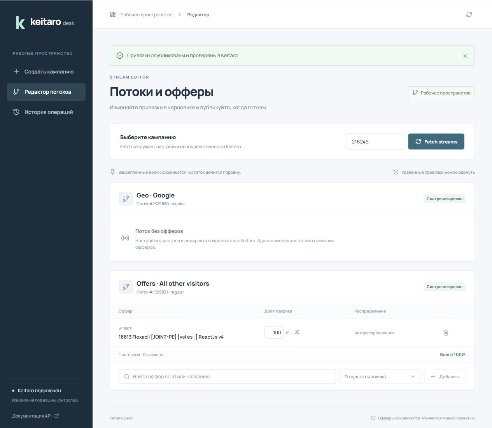

# Проверка результата · 2026-11-20

- Backend: 41 тест, успешный запуск на SQLite и PostgreSQL 17
- Покрытие backend: 94%, расчёт долей покрыт полностью
- Frontend: 5 тестов API-границы и идемпотентности
- TypeScript и Vite: production build успешен
- Ruff и Prettier: проверки пройдены
- npm audit: 0 уязвимостей
- Alembic на PostgreSQL: upgrade head, check, downgrade base, повторный upgrade и check выполнены в отдельной временной схеме
- Docker Compose: образ собран, PostgreSQL и приложение healthy, миграция завершается до старта приложения
- Браузер: создание кампании, Fetch, поиск оффера, Add, Cancel, закрепление, Remove, Push, Bring back и повторная публикация
- На примере видео подтверждено 25% закреплено, 37% и 38% распределено между оставшимися
- После финальной сборки интерфейс подключён к реальному Keitaro; справочники, Fetch, закрепление/снятие и Push собственной тестовой кампании проверены

## Live API

Подробности в [live-verification.md](live-verification.md); создана отдельная кампания 216249, существующие чужие кампании не изменялись, офферы не удалялись

Ключу доступен один оффер: изменение набора с несколькими разными офферами, Remove и Bring back проверены через симулятор HTTP API и интеграционные тесты, но не на реальном сервере

## Границы проверки

- Не выполнялась статистическая проверка распределения большого числа кликов; проверялась конфигурация API и точные значения долей
- Статус HTTP-ошибки и потеря ответа проверены управляемыми сбоями MockTransport; ошибки на реальном сервере намеренно не провоцировались
- В тестовом окружении Starlette выводит предупреждение о будущей замене httpx в TestClient; тесты выполняются успешно
- CI подготовлен, но удалённый GitHub Actions ещё не запускался; публикацию пользователь выполняет самостоятельно
- Точное общее правило округления в исходном редакторе не установлено; выбранный детерминированный порядок описан в architecture.md
